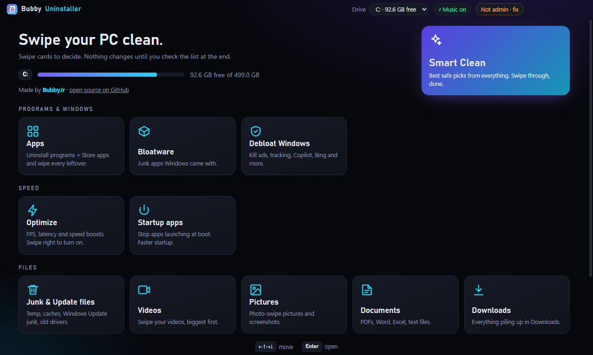
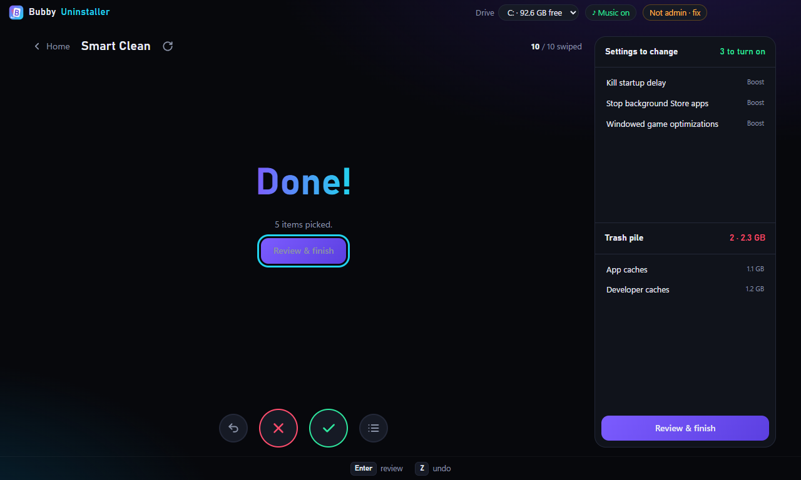
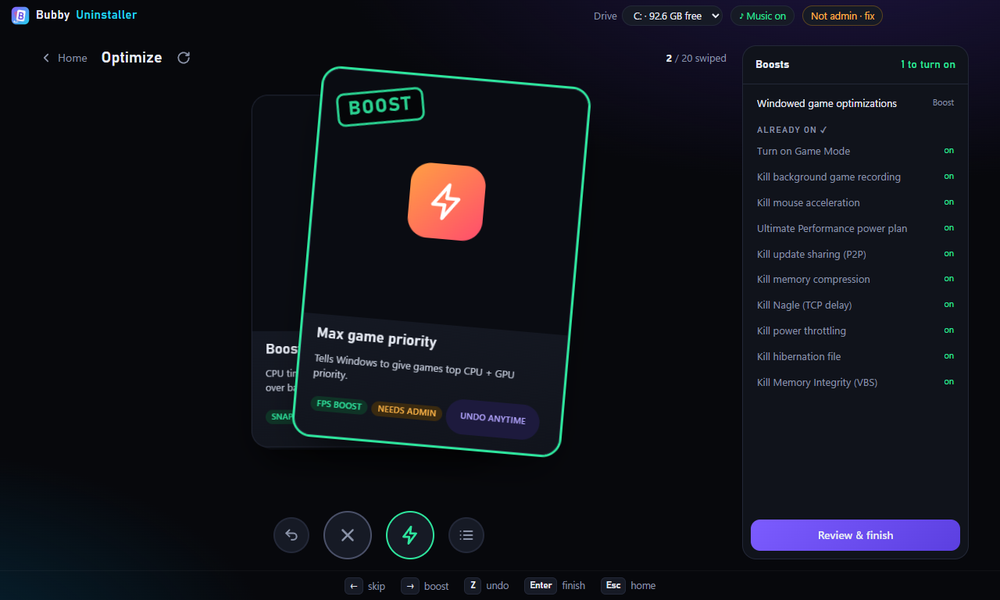
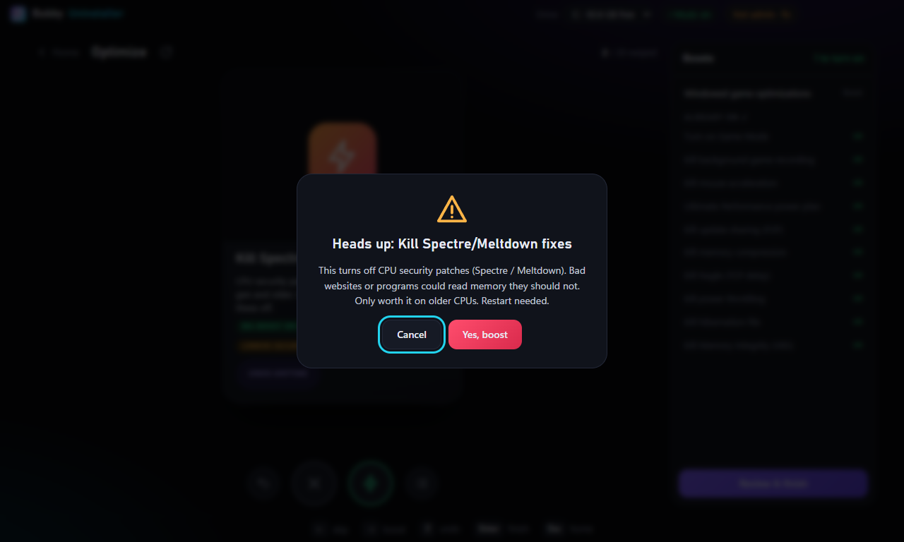
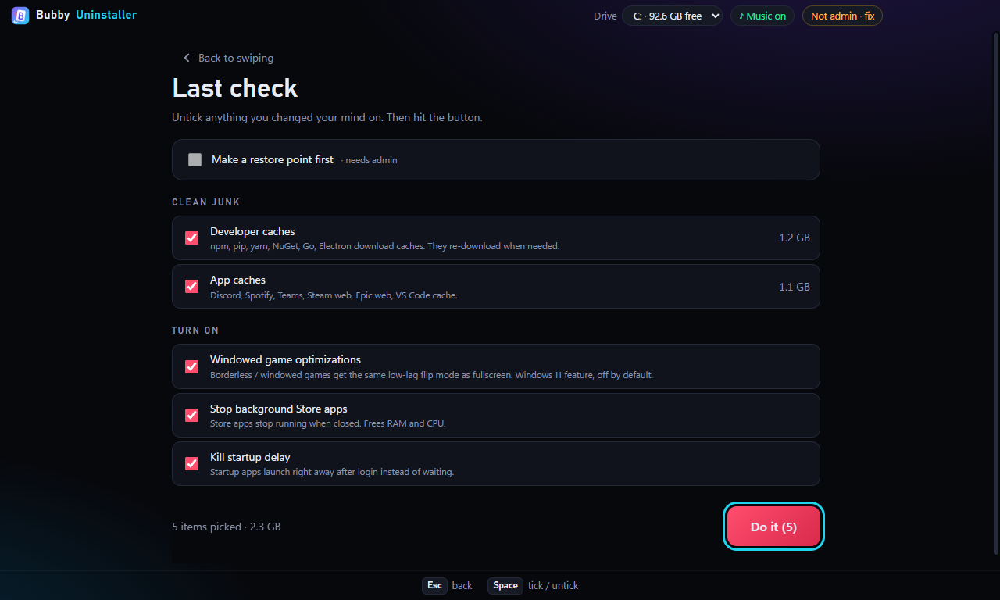

# BubbyUninstaller

A swipe-to-clean uninstaller, debloater and optimizer for Windows.

BubbyUninstaller turns PC cleanup into a card deck. Swipe left to get rid of stuff, swipe right to keep it. Apps, bloatware, junk, Windows Update leftovers, big files, duplicates, startup apps and FPS boosts, all in one console-style app that works with a mouse, keyboard or any controller.

<p align="center">
  
</p>

<p align="center"><a href="https://github.com/GalaxyClipz/BubbyUninstaller/releases"><b>Download Latest Release</b></a> · <a href="https://github.com/GalaxyClipz/BubbyUninstaller/issues"><b>Report a Bug</b></a></p>

<p align="center">
  
  
</p>

---

**Made by BubbyJr ([GalaxyClipz](https://github.com/GalaxyClipz)) and BubbyAi.** BubbyJr: idea, design, testing and direction.
BubbyAi: built the app (swipe decks, uninstall engine, leftover hunter, junk scanner, optimizer, controller support).

Open source under the **MIT License**. Free to use, change and share.

> **Not taking feature requests**, but bug reports are welcome: open an [issue](https://github.com/GalaxyClipz/BubbyUninstaller/issues)
> with your Windows version and what happened, and I'll look at fixing it.

## Download
The newest `BubbyUninstaller-Setup.exe` is on the [Releases](https://github.com/GalaxyClipz/BubbyUninstaller/releases) page. Run it, pick a folder, done.
The app asks for admin when it opens: it needs admin to uninstall programs, clean Windows Update files and apply boosts.

Windows may show *"Windows protected your PC"* because the app isn't code-signed. Click **More info → Run anyway**.

Works on Windows 10 and 11 (64-bit).

## How it works
1. **Pick a tile** (or start with **Smart Clean**, which only picks safe stuff).
2. **Swipe cards.** Cleaning tabs: left = delete, right = keep. Optimize: right = turn the boost on, left = skip.
3. **Last check.** Untick anything you changed your mind on, then hit the button. Nothing is touched before this.

Anything risky (turning off Game Bar, security features) shows a warning first. Restore points are optional.

## What it does
- **Apps:** normal programs and Store apps, biggest first. Silent uninstall when possible, force-remove for broken uninstallers, then a leftover hunt: folders, shortcuts, registry keys (backed up first), startup entries, scheduled tasks and services.
- **Bloatware:** a curated list of preinstalled junk (Candy Crush, TikTok, Clipchamp, News, Copilot…). Nothing Windows needs is ever listed.
- **Debloat Windows:** kill Start menu and lock screen ads, the advertising ID, Bing in Start, Copilot, Recall, telemetry, Widgets, Explorer ads, OneDrive.
- **Optimize:** 30 boosts with honest labels (Hone / Atlas / Winhance-style): Game Mode, GPU scheduling, windowed game optimizations, game priority, telemetry tasks, useless services, mouse acceleration, USB power saving, core parking, timer resolution, memory compression, Nagle, network throttling, dynamic tick, VBS, Spectre fixes and more. Every boost can be turned back off.
- **Startup apps:** the same switch Task Manager uses, fully undoable.
- **Junk & Update files:** temp, browser and app caches, crash and memory dumps, old logs, old driver installers, old Discord / Slack versions, dev caches, Steam leftovers, Windows Update downloads, DISM component cleanup, Delivery Optimization cache, Windows.old and the Recycle Bin.
- **Files:** videos, pictures, documents, downloads, huge files and duplicates with previews. Tiny files get bundled into one card so you're not swiping forever. Pick any drive.
- **Feels like a console:** big tiles, D-pad navigation, Xbox / PlayStation / Switch Pro / generic controllers, and a chill lo-fi loop made live in the app (no music files).

<p align="center">
  
  
</p>

## Build it yourself
```
npm install
npm start          # run in dev
npm run dist       # build dist/BubbyUninstaller-Setup-<version>.exe
```

## For developers (and AIs) fixing bugs
| File | What's inside |
|---|---|
| `main.js` | Everything that touches Windows: app list (registry + Store), uninstall, leftover hunt, file / junk / duplicate scans, bloat removal, tweaks, startup apps, restore points. Runs PowerShell via `ps()`. |
| `lib/data.js` | Data only: bloatware list, `KEEP_APPX` (Store apps never shown), every debloat + optimize tweak (`reg`, `ps`, `undo`, `check`, `confirm`), boost order. Add a boost here. |
| `preload.js` | The bridge: the only functions the UI can call. |
| `src/app.js` | All screens: home, swipe deck, split pile, review, run, leftovers, done. Keyboard + controller input. |
| `src/styles.css` | Look and feel. `src/music.js`: generated background loop. `src/logo.svg`: logo (`npx electron . --make-icon` renders `build/icon.png`). |

Safety rules live in `safe()` in `main.js`: it refuses to delete drive roots, user folders, Program Files roots and anything inside `C:\Windows` except temp / update / dump / log folders.

Dev flags: `npx electron . --selftest` prints a read-only scan of your PC. `npx electron . --shot <folder>` saves screenshots of each screen (it never presses Go).

Build gotchas on Windows: if the project path is very long, NSIS fails with *"could not open file … StdUtils.nsh"*. Build from a short path like `C:\dev\BubbyUninstaller`. If your `cmd.exe` has an AutoRun that prints text (like fastfetch), `npm run dist` fails with *"No JSON content found in output"*.
